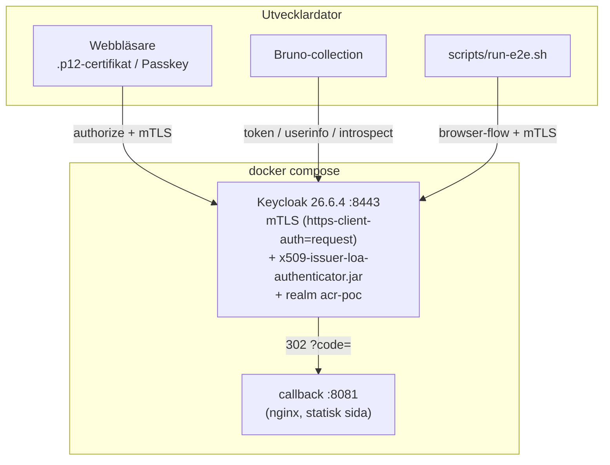
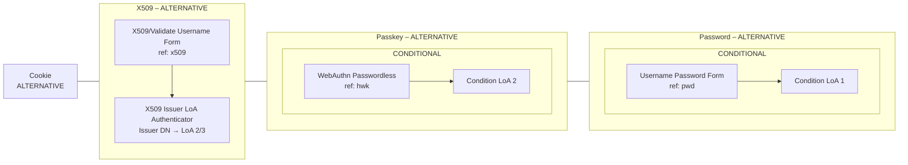

# Keycloak 26.6 – `acr` (LoA) och `amr` för lösenord, Passkey och klientcertifikat

[](.github/workflows/ci.yml)
[](LICENSE)
[](https://www.keycloak.org)
[](spi/pom.xml)
[](bruno/)

En komplett, körbar lokal POC där klientapplikationer kan läsa **tillitsnivå** (`acr`) och **inloggningsmetod**
(`amr`) i både ID token och Access token. Tillitsnivån för certifikatinloggning styrs **enbart av
certifikatets utfärdande CA** via en egen Keycloak-SPI.

| Inloggning | `acr` | `amr` |
|------------|-------|-------|
| Användarnamn + lösenord | `loa1` | `["pwd"]` |
| Passkey (WebAuthn) | `loa2` | `["hwk"]` |
| Klientcertifikat från *Test CA Standard* | `loa2` | `["x509"]` |
| Klientcertifikat från *Test CA High Trust* | `loa3` | `["x509"]` |

Dessutom finns claimet `x509_issuer` (certifikatets Issuer DN) vid certifikatinloggning.

📘 **Dokumentation (svenska):**
[Administratörsguide](docs/admin-guide.md) · [Guide för applikationsägare och utvecklare](docs/app-owner-guide.md)

---

## Kom igång på 5 minuter

**Krav:** Docker (med Compose v2), OpenSSL 3, Python 3.10+ och – för manuella tester – [Bruno](https://www.usebruno.com/) och en webbläsare.
Ingen lokal JDK eller Maven behövs.

```bash
# 1. Skapa test-PKI: 3 CA:er, servercert, klientcert (.p12/.pem), truststore  (~5 s)
scripts/generate-certs.sh

# 2. Bygg SPI:n och kör enhetstesterna (Maven i container)                   (~30 s)
scripts/build-spi.sh

# 3. Starta Keycloak 26.6 (mTLS på 8443) + callback-sida (8081)               (~30 s)
docker compose up -d --wait

# 4. Kör alla end-to-end-tester (lösenord, båda CA:erna, okänd CA, SSO, step-up, passkey)
scripts/run-e2e.sh

# 5. Validera Bruno-collectionen med Bruno CLI
scripts/validate-bruno.sh
```

Förväntat resultat av steg 4:

```text
PASS  password                           acr=loa1 amr=['pwd'] x509_issuer=None
PASS  x509-standard                      acr=loa2 amr=['x509'] x509_issuer=CN=Test CA Standard,O=Example Org,C=SE
PASS  x509-high                          acr=loa3 amr=['x509'] x509_issuer=CN=Test CA High Trust,O=Example Org,C=SE
PASS  x509-unmapped-fails-closed         rejected with HTTP 401 after pages=['x509-confirm']
PASS  sso-keeps-loa3                     SSO: acr=loa3 amr=['x509'] ...
PASS  sso-keeps-loa1                     SSO: acr=loa1 amr=['pwd'] x509_issuer=None
PASS  stepup-pwd-to-loa3-x509            loa1 -> acr=loa3 amr=['pwd', 'x509'] ...
PASS  stepup-loa2-without-passkey-denied no passkey registered -> no code, HTTP 400
PASS  essential-acr-not-met-rejected     password login with essential acr=loa3 rejected ...
PASS  essential-loa3-standard-cert-rejected Standard cert + essential loa3 rejected (HTTP 400)
PASS  essential-loa3-high-cert-accepted  acr=loa3 amr=['x509'] ...
PASS  essential-loa3-stepup-std-rejected pwd session + Standard cert + essential loa3 rejected (HTTP 400)
PASS  acr-values-is-voluntary            acr_values=loa3 + password -> acr=loa1 amr=['pwd'] ... (app must reject)
PASS  passkey-register                   passkey registered via required action
PASS  passkey-login                      acr=loa2 amr=['hwk'] x509_issuer=None
PASS  stepup-pwd-to-loa2-passkey         loa1 -> acr=loa2 amr=['pwd', 'hwk'] x509_issuer=None
```

### Testa i Bruno + webbläsare

1. Importera `certs/testuser-high.p12` och/eller `certs/testuser-standard.p12` (lösenord `changeit`) i webbläsaren,
   och `certs/ca-standard.crt` som betrodd CA. Detaljer: [app-owner-guide § 7](docs/app-owner-guide.md#7-testa-med-bruno).
2. Öppna mappen `bruno/` i Bruno, välj miljön **local**, sätt secret-variabeln `apiClientSecret` = `poc-api-secret-change-me`
   och lägg `certs/ca-standard.crt` som *Custom CA Certificate* i Brunos inställningar.
3. Kör **01 Discovery** → **04 Login - Step-up LoA 3**. Öppna URL:en från konsolen i webbläsaren och välj High Trust-certet.
4. Kopiera koden från `http://localhost:8081/callback` till miljövariabeln `authCode` och kör **05 Token Exchange**.
   Konsolen visar `acr`, `amr` och `x509_issuer`; *Tests* verifierar dem.

| | |
|--|--|
| Admin Console | <https://localhost:8443/admin> – `admin` / `admin` |
| Account Console (registrera passkey) | <https://localhost:8443/realms/acr-poc/account> |
| Testanvändare | `testuser` / `Test1234!` (certifikatens CN = `testuser`) |
| Discovery | <https://localhost:8443/realms/acr-poc/.well-known/openid-configuration> |

> ⚠️ Alla nycklar, lösenord och hemligheter i detta repo är **testvärden** för lokal körning.

---

## Arkitektur



Browser-flödet `browser-acr-amr`:



Varför Passkey/Password ligger i ett `CONDITIONAL`-subflöde inuti ett `ALTERNATIVE`-omslag förklaras i
[admin-guide § 3](docs/admin-guide.md#3-autentiseringsflödet-i-detalj) (kort: villkor utvärderas bara i
`CONDITIONAL`-subflöden i Keycloak 26.6).

### SPI:n

| Klass | Ansvar |
|-------|--------|
| [`X509IssuerLoaAuthenticator`](spi/src/main/java/com/example/keycloak/x509loa/X509IssuerLoaAuthenticator.java) | Hämtar certifikatet via `X509ClientCertificateLookup`, läser Issuer DN, anropar `AcrStore.setLevelAuthenticated(loa)`, sätter user session note `x509_issuer_dn`, fail-closed för okänd CA. I `onTopFlowSuccess`: upprätthåller *essential* `acr` och sparar LoA-kartan i användarsessionen. |
| [`X509IssuerLoaAuthenticatorFactory`](spi/src/main/java/com/example/keycloak/x509loa/X509IssuerLoaAuthenticatorFactory.java) | Provider-id `x509-issuer-loa-authenticator`; konfiguration i Admin UI (`ProviderConfigProperty`). |
| [`IssuerLoaMapping`](spi/src/main/java/com/example/keycloak/x509loa/IssuerLoaMapping.java) | Ren, Keycloak-oberoende mappningslogik (kanonisk DN-jämförelse). |
| [`X509IssuerLoaConfig`](spi/src/main/java/com/example/keycloak/x509loa/X509IssuerLoaConfig.java) | Tolkar authenticator-konfigurationen. |

Konfiguration (Authentication → `browser-acr-amr` → ⚙ på *X509 Issuer LoA Authenticator*):

| Nyckel | Exempel | Default |
|--------|---------|---------|
| `x509loa.issuer-mapping` | `CN=Test CA High Trust,O=Example Org,C=SE::3` (en rad per CA) | – |
| `x509loa.unknown-issuer-policy` | `reject` \| `default-loa` | `reject` |
| `x509loa.default-loa` | `1` | `1` |

---

## Projektstruktur

```text
.
├── spi/                      Maven-projekt: X509IssuerLoaAuthenticator (+ enhetstester)
├── keycloak/realm-export.json  Realm acr-poc (flöde, ACR-LoA-mappning, klienter, mappers, testanvändare)
├── docker-compose.yml        Keycloak 26.6.4 (mTLS) + callback-sida
├── callback/                 Statisk OAuth2-callback (visar code)
├── bruno/                    Bruno-collection (bruno.json, environments/local.bru, *.bru)
├── scripts/
│   ├── generate-certs.sh     Test-PKI med OpenSSL
│   ├── build-spi.sh          Maven-bygge i container
│   ├── run-e2e.sh            Alla end-to-end-tester (i Python-container)
│   ├── e2e_test.py           Lösenord, X.509, SSO, step-up, essential/voluntary acr
│   ├── e2e_passkey_test.py   Passkey med mjukvaru-authenticator
│   └── validate-bruno.sh     Kör collectionen med Bruno CLI
└── docs/
    ├── admin-guide.md        Guide för Keycloak-administratörer
    └── app-owner-guide.md    Guide för applikationsägare och utvecklare
```

## Skript

| Skript | Beskrivning |
|--------|-------------|
| `scripts/generate-certs.sh [--force]` | Skapar `certs/`: `ca-standard`, `ca-high`, `ca-unmapped` (i truststore men ej mappad – för fail-closed-test), `server`, `testuser-{standard,high,unmapped}.{p12,pem,crt,key}`, `truststore.p12`. Lösenord `changeit`. |
| `scripts/build-spi.sh [maven-mål]` | `mvn verify` i `maven:3.9.9-eclipse-temurin-21`, återanvänder `~/.m2`. |
| `scripts/run-e2e.sh` | Kör `e2e_test.py` och `e2e_passkey_test.py` mot den körande miljön. |
| `scripts/e2e_test.py --issue-code <metod> [--acr-values loaN]` | Loggar in (`password`, `testuser-standard`, `testuser-high`) och skriver ut `code`/`verifier`. |
| `scripts/validate-bruno.sh` | Kör alla Bruno-requests med `@usebruno/cli` 4.3.0 (`BRU_SANDBOX=safe` default, eller `developer` – båda verifierade). |

## Testning

| Nivå | Vad | Kommando |
|------|-----|----------|
| Enhetstester | Mappningslogik: DN-normalisering, RDN-ordning, dubbletter, fail-closed, default-LoA, Keycloaks multivalue-format (29 tester) | `scripts/build-spi.sh` |
| Integration/E2E | Riktiga inloggningar mot Keycloak med cookies, mTLS och PKCE; claims i ID token, access token och introspection | `scripts/run-e2e.sh` |
| Bruno | Collectionens skript och tester körs av Bruno CLI | `scripts/validate-bruno.sh` |

## Stoppa / återställa

```bash
docker compose down -v                 # Keycloak kör med dev-databas i containern: realmen importeras på nytt vid nästa start
scripts/generate-certs.sh --force      # ny PKI (importera om .p12 i webbläsaren)
```

## Licens

[Apache-2.0](LICENSE). Se även [SECURITY.md](SECURITY.md) och [CHANGELOG.md](CHANGELOG.md).
