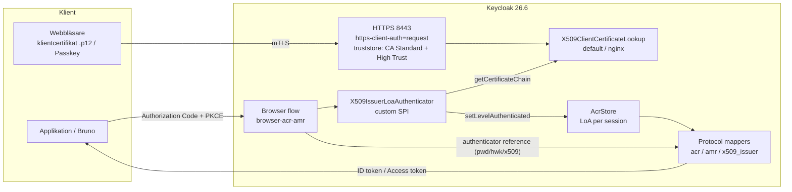
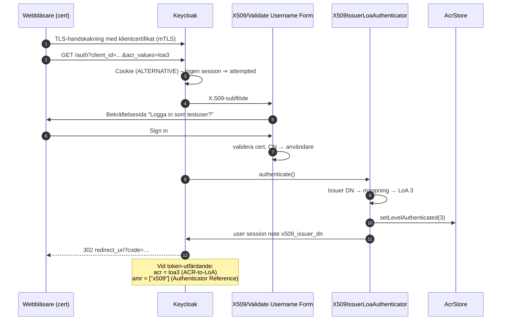

# Administratörsguide – `acr`/`amr` med X.509 Issuer LoA i Keycloak 26.6

Den här guiden riktar sig till Keycloak-administratörer. Den beskriver hur lösningen hänger ihop,
hur SPI:n byggs och installeras, hur du lägger till en ny utfärdande CA och hur du felsöker.

> **Version:** SPI 0.1.1, verifierad mot Keycloak **26.6.4**.

## Innehåll

1. [Arkitekturöversikt](#1-arkitekturöversikt)
2. [Bygga, installera och uppgradera SPI-JAR:en](#2-bygga-installera-och-uppgradera-spi-jaren)
3. [Autentiseringsflödet i detalj](#3-autentiseringsflödet-i-detalj)
4. [Lägga till en ny Issuing CA → LoA-mappning](#4-lägga-till-en-ny-issuing-ca--loa-mappning)
5. [Truststore, mTLS och reverse proxy](#5-truststore-mtls-och-reverse-proxy)
6. [Felsökning](#6-felsökning)
7. [Kända begränsningar](#7-kända-begränsningar)
8. [Produktionssättning](#8-produktionssättning)

---

## 1. Arkitekturöversikt

### Komponenter



| Del | Ansvar |
|-----|--------|
| **TLS / truststore** | Keycloak ber om (men kräver inte) ett klientcertifikat i TLS-handskakningen och accepterar bara certifikat som kedjar till en CA i truststore. |
| **`X509/Validate Username Form`** (inbyggd) | Validerar certifikatet (giltighetstid, key usage, EKU, ev. CRL/OCSP) och mappar det till en användare (här: Subject CN → användarnamn). Bär **Authenticator Reference `x509`** → `amr`. |
| **`X509 Issuer LoA Authenticator`** (denna SPI) | Läser certifikatets *Issuer DN*, slår upp LoA i en konfigurerbar mappning och anropar `AcrStore.setLevelAuthenticated(loa)`. Sparar Issuer DN i user session note `x509_issuer_dn`. Okänd CA ⇒ fail-closed (eller default-LoA om så konfigurerats). |
| **`Condition - Level of Authentication`** (inbyggd) | Sätter LoA 2 (Passkey) respektive LoA 1 (lösenord) när respektive subflöde lyckas, och styr step-up vid SSO. |
| **`AcrStore`** | Keycloaks lagring av uppnådd nivå: aktuell nivå i autentiseringssessionen och en *LoA-karta* (`nivå → tidpunkt`) i användarsessionen som används vid SSO och step-up. |
| **ACR-to-LoA-mappning** (realm) | `loa1 → 1`, `loa2 → 2`, `loa3 → 3`. Översätter nivåsiffran till `acr`-strängen i token och `acr_values` från klienten till en nivå. |
| **Authenticator Reference** (per execution) | `pwd`, `hwk`, `x509`. Keycloak lagrar vilka executions som slutförts; `oidc-amr-mapper` skriver deras referenser till `amr`. |
| **Protocol mappers** på klienten | `oidc-acr-mapper` (`acr`), `oidc-amr-mapper` (`amr`), `oidc-usersessionmodel-note-mapper` (`x509_issuer` ← `x509_issuer_dn`). Alla i både ID token och Access token. |

### Vad hamnar i token?

| Inloggningsmetod | `acr` | `amr` | `x509_issuer` |
|------------------|-------|-------|---------------|
| Användarnamn + lösenord | `loa1` | `["pwd"]` | – |
| Passkey (WebAuthn, discoverable credential) | `loa2` | `["hwk"]` | – |
| Klientcertifikat från **Test CA Standard** | `loa2` | `["x509"]` | `CN=Test CA Standard,O=Example Org,C=SE` |
| Klientcertifikat från **Test CA High Trust** | `loa3` | `["x509"]` | `CN=Test CA High Trust,O=Example Org,C=SE` |
| Klientcertifikat från okänd (ej mappad) CA | – (inloggning nekas) | – | – |
| Lösenord, sedan step-up med High Trust-cert | `loa3` | `["pwd","x509"]` | `CN=Test CA High Trust,...` |

Alla rader ovan verifieras automatiskt av `scripts/run-e2e.sh`.

### Sekvens: inloggning med klientcertifikat



---

## 2. Bygga, installera och uppgradera SPI-JAR:en

### Bygga

Kräver Docker (ingen lokal JDK/Maven behövs):

```bash
scripts/build-spi.sh            # mvn verify i maven:3.9.9-eclipse-temurin-21
# -> spi/target/x509-issuer-loa-authenticator.jar
```

Med lokal JDK 21 + Maven: `cd spi && mvn verify`.

`pom.xml` pekar på `keycloak.version` (26.6.4). Alla Keycloak-beroenden har scope `provided` – JAR:en
innehåller bara SPI:ns egna klasser (≈15 kB) och inga tredjepartsbibliotek.

### Installera

1. Kopiera JAR:en till `/opt/keycloak/providers/` (i containeravbilden eller via volym).
2. Kör `kc.sh build` (produktionsläge) – eller starta med `start-dev`, som bygger automatiskt.
3. Starta Keycloak. I loggen ska följande varning synas (den är förväntad, `Authenticator` är en intern SPI):

   ```
   KC-SERVICES0047: x509-issuer-loa-authenticator (...X509IssuerLoaAuthenticatorFactory) is implementing the internal SPI authenticator.
   ```

4. Kontrollera i **Admin Console → Realm settings → Provider info** (eller *Server info → Providers*)
   att `x509-issuer-loa-authenticator` finns under `authenticator`.

För en egen Keycloak-avbild:

```dockerfile
FROM quay.io/keycloak/keycloak:26.6.4@sha256:0aae0de7fca85525f727d3354df17896092de8bb26ae4c12d89c77e5df8cbce4 AS builder
COPY x509-issuer-loa-authenticator.jar /opt/keycloak/providers/
RUN /opt/keycloak/bin/kc.sh build

FROM quay.io/keycloak/keycloak:26.6.4@sha256:0aae0de7fca85525f727d3354df17896092de8bb26ae4c12d89c77e5df8cbce4
COPY --from=builder /opt/keycloak/ /opt/keycloak/
ENTRYPOINT ["/opt/keycloak/bin/kc.sh"]
```

### Uppgradera

| Scenario | Åtgärd |
|----------|--------|
| Ny SPI-version | Ersätt JAR:en, kör `kc.sh build`, rulla om podarna. Konfigurationen ligger i realmen (authenticator config) och påverkas inte. |
| Ny Keycloak-version | Sätt `keycloak.version` i `spi/pom.xml` till exakt samma version, kör `scripts/build-spi.sh` och `scripts/run-e2e.sh` mot den nya versionen **innan** produktion. `Authenticator`, `AcrStore` och `X509ClientCertificateLookup` är interna API:er som kan ändras mellan minor-versioner. Dependabot ignorerar både `org.keycloak:*` och Keycloak-imagen, så POM och `docker-compose.yml` uppgraderas alltid tillsammans för hand. |
| Konfigurationsändring (mappning) | Ingen omstart – ändringen gäller nästa inloggning. |

---

## 3. Autentiseringsflödet i detalj

Flödet `browser-acr-amr` (kopia av *browser*, satt som realmens *Browser flow*):

```
browser-acr-amr
├── Cookie                                               ALTERNATIVE
├── browser-acr-amr - X509                               ALTERNATIVE
│   ├── X509/Validate Username Form   (ref: x509)        REQUIRED
│   ├── X509 Issuer LoA Authenticator (mappning)         REQUIRED
│   └── Condition - Level of Authentication (LoA 3)      REQUIRED   ← "vilande", se nedan
├── browser-acr-amr - Passkey                            ALTERNATIVE
│   └── browser-acr-amr - Passkey LoA2                   CONDITIONAL
│       ├── WebAuthn Passwordless Authenticator (ref: hwk)  REQUIRED
│       └── Condition - Level of Authentication (LoA 2)  REQUIRED
└── browser-acr-amr - Password                           ALTERNATIVE
    └── browser-acr-amr - Password LoA1                  CONDITIONAL
        ├── Username Password Form (ref: pwd)            REQUIRED
        └── Condition - Level of Authentication (LoA 1)  REQUIRED
```

### Varför avviker strukturen från "Alternative-subflöde + Condition"?

Kravet beskrev Passkey- och lösenordssubflödena som `ALTERNATIVE` med en `Condition - Level of Authentication`
direkt i. Det fungerar **inte** i Keycloak 26.6, vilket har verifierats i källkoden och i testmiljön:

1. **Villkor utvärderas bara i `CONDITIONAL`-subflöden.** I ett `ALTERNATIVE`- eller vanligt subflöde filtreras
   condition-executions bort (`DefaultAuthenticationFlow.fillListsOfExecutions`). Villkorets callback
   `onParentFlowSuccess`, som är det som faktiskt sätter LoA, anropas då aldrig – Passkey skulle få `acr=loa1`.
2. **`CONDITIONAL` kan inte ligga bredvid alternativen på toppnivån.** Keycloak behandlar `CONDITIONAL` som
   `REQUIRED`, och så fort ett subflöde innehåller en required-execution ignoreras alla `ALTERNATIVE` (även Cookie).

Lösningen är ett `ALTERNATIVE`-"omslag" runt ett `CONDITIONAL`-subflöde. Semantiken blir exakt den
efterfrågade: tre alternativa metoder, där Passkey ger LoA 2 och lösenord LoA 1.

**Ordningen inne i de villkorade subflödena** (authenticatorn *före* villkoret) är också avsiktlig.
Keycloaks "Try another way"-lista byggs bara från hela toppflödet om authenticatorn är *första* execution i
sitt subflöde; annars visas bara den aktuella metoden och länken försvinner. Villkoren utvärderas oavsett
position.

### Den "vilande" LoA 3-conditionen i X.509-subflödet

X.509-subflödet är inte villkorat, så conditionen där utvärderas aldrig vid körning. Den finns bara för att
registrera **max age för LoA 3**. Keycloak läser max age per nivå från *alla* `Condition - Level of
Authentication` i flödet när den avgör vilka tidigare nivåer som fortfarande gäller vid SSO
(`AcrStore.getHighestAuthenticatedLevelFromPreviousAuthentication`). Utan den har LoA 3 max age 0 och en
SSO-inloggning efter en High Trust-inloggning skulle tappa nivån. LoA 2 (Standard-CA) använder Passkey-conditionens
max age. **Ta inte bort den** – och lägg till en motsvarande condition om du inför en LoA 4.

### Hur SPI:n samverkar med `AcrStore`

- `authenticate()` anropar `AcrStore.setLevelAuthenticated(loa)`, som sätter nivån för aktuell inloggning och
  skriver `nivå → tidpunkt` i LoA-kartan.
- SPI:ns factory implementerar `AuthenticationFlowCallbackFactory`. När hela flödet lyckas gör
  `onTopFlowSuccess` samma två saker som Keycloaks egen condition, eftersom ingen condition utvärderas på X.509-vägen:
  1. **Upprätthåller *essential* `acr`.** Har klienten begärt nivån som obligatorisk (`claims` med
     `"essential": true`) och nivån inte uppnåddes, avbryts inloggningen (`ACR_NOT_FULFILLED`). Utan detta
     skulle ett certifikat från Standard-CA (LoA 2) godkännas för ett obligatoriskt `loa3`-krav – verifierat
     och täckt av e2e-testerna `essential-loa3-*`.
  2. **Kopierar LoA-kartan till användarsessionen.** Utan detta skulle SSO efter en ren X.509-inloggning ge `acr` = `0`.
- Om en tidigare nivå är högre (t.ex. step-up) behålls den högsta giltiga nivån i kartan.

### Hur `amr` uppstår

`amr` byggs av Keycloak från de executions som slutförts i sessionen och deras **Authenticator Reference**
(`default.reference.value`). Varje referens har en **max age** (`default.reference.maxAge`, sekunder).
**Standardvärdet är 0**, vilket betyder att referensen bara gäller i samma sekund som inloggningen – efter det
försvinner metoden ur `amr` vid token refresh och SSO. I denna POC är max age 36000 s (= `SSO Session Max`).

Konfigurera i Admin Console: *Authentication → browser-acr-amr → ⚙ på executionen → Authenticator Reference*
och *Authenticator Reference Max Age*.

### Passkey

- Flödet använder **WebAuthn Passwordless Authenticator** (`webauthn-authenticator-passwordless`), inte
  *WebAuthn Authenticator*. Den senare är en andrafaktor som kräver att användaren redan är identifierad och kan
  därför inte vara en egen förstafaktor.
- Policy: *Authentication → Policies → Webauthn Passwordless Policy* (`rpId = localhost`, resident key = Yes,
  user verification = required).
- En passkey kan inte förprovisioneras i realm-exporten. Användaren registrerar den efter en lösenordsinloggning:
  Account Console → *Signing in → Passkey → Set up*, eller via required action `webauthn-register-passwordless`
  (t.ex. `kc_action=webauthn-register-passwordless` i authorize-anropet).
- Utan identifierad användare visar Keycloak lösenordsformuläret först (icke-credential-baserade metoder listas
  före användarlösa credential-metoder) med länken **Try another way → Passkey**. Det är Keycloaks inbyggda
  ordning, inte ett fel.

---

## 4. Lägga till en ny Issuing CA → LoA-mappning

### Steg 1 – Ta fram Issuer DN i rätt format

Mappningen jämför certifikatets `getIssuerX500Principal()` med det konfigurerade DN:et i **kanonisk form**
(RFC 2253). Ta fram DN:et ur CA-certifikatet (CA:ns *Subject* = klientcertifikatens *Issuer*):

```bash
openssl x509 -in ny-ca.crt -noout -subject -nameopt RFC2253
# subject=CN=Ny CA,O=Example Org,C=SE
```

| Format | Exempel | Fungerar? |
|--------|---------|-----------|
| RFC 2253 (rekommenderat) | `CN=Ny CA,O=Example Org,C=SE` | ✅ |
| Med mellanslag / annan skiftläge | `cn=ny ca, o=example org, c=se` | ✅ normaliseras |
| OID i stället för namn | `2.5.4.3=Ny CA,O=Example Org,C=SE` | ✅ normaliseras |
| Omvänd ordning (OpenSSL default / LDAP-visning) | `C=SE, O=Example Org, CN=Ny CA` | ❌ annat DN |
| OpenSSL "oneline" | `/C=SE/O=Example Org/CN=Ny CA` | ❌ ogiltigt DN, inloggning nekas + ERROR i loggen |

> Matchningen sker på **hela** DN:et, aldrig bara CN. En falsk CA med samma CN men annan `O` får ingen nivå.

### Steg 2 – Lägg CA:n i truststore

Utan detta avvisas certifikatet redan i TLS-handskakningen (se [avsnitt 5](#5-truststore-mtls-och-reverse-proxy)).

```bash
keytool -importcert -noprompt -alias ny-ca -file ny-ca.crt \
        -keystore truststore.p12 -storetype PKCS12 -storepass "$TRUSTSTORE_PASSWORD"
```

Starta om Keycloak (truststore läses vid start). Bakom proxy: lägg CA:n i proxyns `ssl_client_certificate`.

### Steg 3 – Lägg till mappningen i Admin UI

1. **Admin Console → realm `acr-poc` → Authentication → `browser-acr-amr`**.
2. Leta upp **X509 Issuer LoA Authenticator** i subflödet `browser-acr-amr - X509` och klicka på **⚙ (Settings)**.
3. Under **Issuer DN to LoA mapping**, klicka **Add** och ange en rad på formen

   ```
   <Issuer DN>::<nivå>
   ```

   t.ex. `CN=Ny CA,O=Example Org,C=SE::3`. Separatorn är `::` (sista förekomsten används, så DN:et får innehålla `:`).
4. **Unknown issuer policy**: `reject` (fail-closed, rekommenderat) eller `default-loa`.
5. **Default LoA for unknown issuers**: används bara med `default-loa`.
6. **Save**.

Samma sak via Admin REST/`kcadm.sh`:

```bash
kcadm.sh get authentication/flows/browser-acr-amr/executions -r acr-poc   # hitta authenticationConfig-id
kcadm.sh update authentication/config/<config-id> -r acr-poc \
  -s 'config."x509loa.issuer-mapping"="CN=Test CA Standard,O=Example Org,C=SE::2##CN=Test CA High Trust,O=Example Org,C=SE::3##CN=Ny CA,O=Example Org,C=SE::3"'
```

(Flera värden lagras separerade med `##`.)

### Steg 4 – Ny nivå? Uppdatera även realmen

Om nivån inte redan finns (t.ex. LoA 4):

1. **Realm settings → General → ACR to LoA Mapping**: lägg till `loa4 → 4`.
2. Lägg till en vilande **Condition - Level of Authentication** (Level 4, Max Age = SSO-livslängd) i X.509-subflödet.
3. Informera applikationsägarna om det nya `acr`-värdet.

### Steg 5 – Verifiera

Logga in med ett certifikat från den nya CA:n och kontrollera `acr`/`x509_issuer` i token (Bruno *05 Token Exchange*).
Med `DEBUG` på `com.example.keycloak.x509loa` loggas: `X.509 issuer 'CN=Ny CA,...' -> LoA 3 (mapped)`.

### Konfigurationsreferens

| Nyckel | Typ | Default | Beskrivning |
|--------|-----|---------|-------------|
| `x509loa.issuer-mapping` | Multivalued string | – | `<Issuer DN>::<nivå>` per CA |
| `x509loa.unknown-issuer-policy` | `reject` \| `default-loa` | `reject` | Saknas/blankt ⇒ `reject` |
| `x509loa.default-loa` | heltal ≥ 0 | `1` | Endast för `default-loa` |

Ogiltig konfiguration (felaktigt DN, icke-numerisk nivå, dubblett) ⇒ **alla** X.509-inloggningar nekas och ett
`ERROR` loggas. Keycloak 26.6 har ingen hook för att validera authenticator-konfiguration när den sparas.

---

## 5. Truststore, mTLS och reverse proxy

### Alternativ A – mTLS direkt i Keycloak (används i POC:n)

```text
--https-certificate-file=/opt/keycloak/conf/certs/server-chain.crt
--https-certificate-key-file=/opt/keycloak/conf/certs/server.key
--https-client-auth=request                     # be om cert, men kräv inte (lösenord/passkey ska fungera)
--https-trust-store-file=/opt/keycloak/conf/certs/truststore.p12
--https-trust-store-password=<från Secret>
--https-trust-store-type=PKCS12
--spi-x509cert-lookup--provider=default         # läs certet från TLS-sessionen
```

- `request` (inte `required`): med `required` kan användare utan certifikat inte nå inloggningssidan alls.
- Truststore ska bara innehålla de CA:er som får användas för inloggning. Ett certifikat från en CA utanför
  truststore skickas aldrig av webbläsaren/avvisas i handskakningen och når aldrig SPI:n.
- POC:n lägger avsiktligt även *Test CA Unmapped* i truststore för att kunna testa SPI:ns fail-closed-gren.

### Alternativ B – NGINX (eller annan proxy) terminerar TLS

Proxyn validerar klientcertifikatet och skickar det vidare i en header. Keycloak läser headern via en
proxy-specifik `X509ClientCertificateLookup`. SPI:n fungerar oförändrad eftersom den använder samma lookup.

```nginx
server {
    listen 443 ssl;
    server_name sso.example.org;

    ssl_certificate         /etc/nginx/tls/server-chain.crt;
    ssl_certificate_key     /etc/nginx/tls/server.key;
    ssl_client_certificate  /etc/nginx/tls/login-cas.pem;   # Test CA Standard + Test CA High Trust
    ssl_verify_client       optional;                        # motsvarar https-client-auth=request
    ssl_verify_depth        2;

    location / {
        proxy_pass https://keycloak:8443;
        proxy_set_header Host              $host;
        proxy_set_header X-Forwarded-For   $proxy_add_x_forwarded_for;
        proxy_set_header X-Forwarded-Proto https;
        proxy_set_header X-Forwarded-Host  $host;
        # Skriv ALLTID över headern så att en klient inte kan injicera ett eget certifikat:
        proxy_set_header ssl-client-cert   $ssl_client_escaped_cert;
    }
}
```

```text
--proxy-headers=xforwarded
--spi-x509cert-lookup--provider=nginx
--spi-x509cert-lookup--nginx--ssl-client-cert=ssl-client-cert
--spi-x509cert-lookup--nginx--ssl-cert-chain-prefix=USELESS
--spi-x509cert-lookup--nginx--certificate-chain-length=2
# --spi-x509cert-lookup--nginx--trust-proxy-verification=true   # endast om proxyn är enda vägen in
```

Säkerhetskrav för proxyläget:

- Keycloak får **bara** vara nåbar via proxyn (NetworkPolicy/brandvägg). Annars kan vem som helst skicka en
  förfalskad `ssl-client-cert`-header.
- Proxyn måste skriva över (inte vidarebefordra) inkommande `ssl-client-cert`.
- Med `trust-proxy-verification=false` (default) validerar Keycloak kedjan igen mot sin egen truststore – behåll
  därför truststore även i proxyläget.

---

## 6. Felsökning

### Slå på loggning

```text
--log-level=INFO,com.example.keycloak.x509loa:DEBUG,org.keycloak.authentication.authenticators.x509:DEBUG
# Hela flödesbeslutet (villkor, LoA, valda executions) – mycket pratigt:
--log-level=INFO,org.keycloak.authentication:TRACE
```

Aktivera även **Realm settings → Events → User events** för att se `LOGIN_ERROR` med fel som
`x509_issuer_not_mapped`, `invalid_x509_loa_configuration` och `no_client_certificate`.

### Vanliga problem

| Symptom | Trolig orsak | Åtgärd |
|---------|--------------|--------|
| Certifikatinloggning nekas: *"…not approved for login"*, logg `Rejecting X.509 login: issuer '…' is not in the LoA mapping` | DN i mappningen matchar inte (omvänd RDN-ordning, OpenSSL-oneline, fel `O`/`C`) | Kopiera DN:et exakt från loggraden (RFC 2253) eller `openssl … -nameopt RFC2253` |
| Logg `Invalid X.509 issuer LoA configuration` | Syntaxfel i en mappningsrad, dubblett eller ogiltig default-LoA | Rätta raden; SPI:n är fail-closed tills dess |
| Ingen certifikatfråga i webbläsaren / X.509 hoppas över | CA saknas i truststore, cert saknar EKU `clientAuth`, eller certet är inte importerat i webbläsaren | Kontrollera truststore och `openssl x509 -text`; starta om webbläsaren efter import |
| `amr` saknas efter refresh eller SSO | `Authenticator Reference Max Age` = 0 (default) | Sätt max age ≥ SSO-sessionens livslängd |
| `acr` blir `0` vid SSO | Nivån saknas i LoA-kartan eller dess max age har gått ut | Kontrollera `loa-max-age` på conditions (inkl. vilande LoA 3) |
| Passkey ger `acr=loa1` | Condition ligger i ett `ALTERNATIVE`-subflöde | Använd omslag + `CONDITIONAL`-subflöde (avsnitt 3) |
| "Try another way" saknas | Condition ligger *före* authenticatorn i subflödet | Lägg authenticatorn först |
| Step-up till `loa2` ger felsida | Användaren har ingen passkey (cookien har redan identifierat användaren) | Registrera passkey, eller använd certifikat |
| Klienten begär `acr_values=loa3` men får `loa1` | `acr_values` är *frivilligt* (OIDC "voluntary claim") | Applikationen ska avvisa; för hård kontroll använd `claims` med `"essential": true` |
| `amr` saknas i introspection-svaret | `oidc-amr-mapper` stöder inte introspection i 26.6 | Läs `amr` ur den validerade JWT:n |
| Inloggning med cert lyckas men fel användare | X.509-mappning (Subject CN → användarnamn) | Ändra *User mapping method* i X509/Validate Username Form |

### SSO och step-up – så beter sig Cookie-authenticatorn

- Har sessionen redan en nivå ≥ begärd (`acr_values`) ⇒ tyst SSO, `acr` = högsta giltiga nivå.
- Begärs en högre nivå ⇒ Cookie markeras *attempted*, användaren är identifierad och flödet fortsätter med
  alternativen. Både tidigare och nya metoder hamnar i `amr` (t.ex. `["pwd","x509"]`).
- `prompt=login` / `max_age=0` ⇒ full omautentisering; tidigare nivåer räknas inte.

---

## 7. Kända begränsningar

- `x509_issuer_dn` är en *user session note* och speglar den senaste X.509-inloggningen i sessionen.
- `amr` exponeras inte via introspection eller UserInfo i Keycloak 26.6.
- Step-up till LoA 2 för en användare utan passkey och utan certifikat avbryts med en felsida i stället för att
  erbjuda ett annat alternativ.
- Ingen validering av SPI-konfigurationen när den sparas i Admin UI (valideras vid inloggning, fail-closed).

---

## 8. Produktionssättning

POC:n är byggd för att köras lokalt med ett kommando. Mycket av det som gör det enkelt är **direkt olämpligt i
produktion**. Det här avsnittet beskriver vad som måste ändras och i vilken ordning. Avsnittet är en checklista,
inte en färdig driftsättning: det levereras inget Helm-diagram eller produktionsrealm i repot.

> Optionsnamnen nedan är kontrollerade mot keycloak.org (26.x). Kodblock märkta *exempel* är inte körda i den
> här POC:n – verifiera mot dokumentationen för exakt den version ni kör.

### 8.1 Från POC till produktion – översikt

| Område | I POC:n | I produktion |
|--------|---------|--------------|
| Startläge | `start-dev` (bygger vid varje start, dev-databas i containern) | `start --optimized` med en förbyggd avbild ([8.2](#82-bygg-en-egen-keycloak-avbild)) |
| Databas | Inbyggd dev-databas, försvinner med containern | Extern databas, t.ex. PostgreSQL (`--db=postgres`, `--db-url`, `--db-username`, `--db-password`) |
| Realm | `--import-realm` av `keycloak/realm-export.json` | Egen produktionsrealm, versionshanterad ([8.4](#84-realmen)) – **importera aldrig POC-exporten** |
| PKI | Självsignerade test-CA:er från `generate-certs.sh` | Organisationens riktiga utfärdande CA:er ([8.5](#85-certifikat-och-revokering)) |
| Hemligheter | `admin`/`admin`, `changeit`, `poc-api-secret-change-me` i klartext | Kubernetes `Secret`/secrets manager, unika per miljö ([8.6](#86-hemligheter-och-administratörer)) |
| mTLS | Keycloak terminerar TLS direkt på 8443 | Passthrough eller proxy som vidarebefordrar certet ([8.3](#83-mtls-i-kubernetes--openshift)) |
| Passkey | `rpId = localhost` | `rpId` = produktionsdomänen ([8.4](#84-realmen)) |
| Loggning | `DEBUG` för SPI:n och X.509 | `INFO` – DEBUG-raderna innehåller Subject/Issuer-DN, d.v.s. personuppgifter |

### 8.2 Bygg en egen Keycloak-avbild

Utgå från Dockerfilen i [avsnitt 2](#installera) och lägg till build-tidsoptioner. I `start --optimized`-läge
läses build-tidsoptioner bara vid `kc.sh build`, och **valet av `x509cert-lookup`-provider är en sådan option**.

```dockerfile
# Exempel
FROM quay.io/keycloak/keycloak:26.6.4@sha256:0aae0de7fca85525f727d3354df17896092de8bb26ae4c12d89c77e5df8cbce4 AS builder
COPY x509-issuer-loa-authenticator-0.1.1.jar /opt/keycloak/providers/
RUN /opt/keycloak/bin/kc.sh build \
      --db=postgres \
      --health-enabled=true \
      --metrics-enabled=true \
      --spi-x509cert-lookup--provider=default     # nginx/haproxy/apache/traefik/envoy/rfc9440 bakom proxy (8.3)

FROM quay.io/keycloak/keycloak:26.6.4@sha256:0aae0de7fca85525f727d3354df17896092de8bb26ae4c12d89c77e5df8cbce4
COPY --from=builder /opt/keycloak/ /opt/keycloak/
ENTRYPOINT ["/opt/keycloak/bin/kc.sh"]
CMD ["start", "--optimized"]
```

- Hämta JAR:en från [GitHub-releasen](https://github.com/JoWe112/kc-acr-amr-poc/releases) och verifiera den:
  `sha256sum -c x509-issuer-loa-authenticator-0.1.1.jar.sha256`. Bygg den inte på en utvecklardator.
- Keycloak-versionen i avbilden **måste** vara den som står i JAR:ens manifest (`Keycloak-Version`, se
  [Uppgradera](#uppgradera)).
- Skanna avbilden med Trivy innan den publiceras och bygg om regelbundet för att få säkerhetsrättningar.

Runtime-konfiguration (env eller `args`, hemligheter från `Secret`) – *exempel*:

```text
--hostname=https://sso.example.org
--hostname-admin=https://sso-admin.example.internal    # admin-konsolen på ett eget, internt värdnamn
--db-url=jdbc:postgresql://db.example.internal/keycloak
--db-username=keycloak            --db-password=<från Secret>
--https-certificate-file=/tls/tls.crt                  --https-certificate-key-file=/tls/tls.key
--https-client-auth=request
--https-trust-store-file=/truststore/login-cas.p12     --https-trust-store-password=<från Secret>
--https-trust-store-type=PKCS12
--log-level=INFO
```

- Probes mot management-porten **9000** (`/health/ready` för readiness). Exponera inte port 9000 utanför klustret.
- Management-gränssnittet ärver mTLS-inställningarna. Med `request` fungerar probes utan certifikat; använder ni
  `required` någonstans, sätt `--https-management-client-auth=none` så att probes inte nekas.
- Kör flera repliker. LoA-kartan och `x509_issuer_dn` är *user session notes* och följer med sessionen
  (replikering/persistenta sessioner i Keycloak 26) – SPI:n kräver ingen extra klusterkonfiguration, men JAR:en
  måste finnas i avbilden på **alla** noder.

### 8.3 mTLS i Kubernetes / OpenShift

Den vanligaste felkällan i produktion: **klientcertifikatet försvinner om TLS termineras före Keycloak.** En
OpenShift Route med `edge`- eller `reencrypt`-terminering, eller en vanlig Ingress som terminerar TLS, skickar
aldrig vidare webbläsarens certifikat. X.509-subflödet hoppas då tyst över och alla användare hamnar på lösenord.

| Alternativ | Hur | Keycloak-konfiguration |
|------------|-----|------------------------|
| **A – Passthrough (rekommenderas)** | OpenShift Route `tls.termination: passthrough`, eller en TCP-lastbalanserare (L4). Keycloak gör TLS och mTLS själv, som i POC:n. | `--spi-x509cert-lookup--provider=default`, truststore enligt [avsnitt 5](#alternativ-a--mtls-direkt-i-keycloak-används-i-pocn). Sätt **inte** `--proxy-headers`. |
| **B – Proxy vidarebefordrar certet** | Proxyn kräver/begär klientcert, validerar det och skickar det i en header (`ssl-client-cert`). | Rätt lookup-provider vid `kc.sh build`, `--proxy-headers=xforwarded` och kraven i [avsnitt 5](#alternativ-b--nginx-eller-annan-proxy-terminerar-tls). |

För alternativ B gäller utöver avsnitt 5:

- Keycloak-podarna får bara ta emot trafik från proxyn – lås med en `NetworkPolicy`, och sätt
  `--proxy-trusted-addresses` till proxyns adresser.
- Proxyn ska *begära* (inte kräva) klientcert, motsvarande `https-client-auth=request`, annars kan användare utan
  certifikat inte nå inloggningssidan.
- Använd `trust-proxy-verification=false` (default) så att Keycloak validerar kedjan igen mot sin egen truststore.
- ingress-nginx (annotationerna `auth-tls-*`) är avvecklat – välj en underhållen controller/gateway och kontrollera
  att den kan vidarebefordra klientcertet.

**UX-effekt av `request`:** webbläsaren kan visa en certifikatdialog på varje sida under värdnamnet där mTLS är
aktivt. Lägg admin-konsolen på ett eget värdnamn (`--hostname-admin`) och överväg att låta bara inloggningsvärdnamnet
begära certifikat.

### 8.4 Realmen

`keycloak/realm-export.json` innehåller testdata och får **inte** importeras i produktion:

| I exporten | Åtgärd i produktion |
|------------|---------------------|
| Användaren `testuser` / `Test1234!` | Ta bort; användare kommer från er IdP/LDAP |
| Publik klient `bruno` med `localhost`-redirect-URI:er | Ta bort; skapa riktiga klienter med exakta redirect-URI:er |
| Klienten `poc-api` med hemligheten `poc-api-secret-change-me` | Ny hemlighet (eller `private_key_jwt`) per miljö, lagrad i secrets manager |
| Test-CA-DN:erna i `x509loa.issuer-mapping` | Era CA:ers DN ([avsnitt 4](#4-lägga-till-en-ny-issuing-ca--loa-mappning)) |
| WebAuthn Passwordless `rpId = localhost` | Produktionsdomänen, t.ex. `example.org` |
| `sslRequired: external` | `all` |
| Ingen lösenordspolicy (`passwordPolicy` saknas) | Lösenordspolicy enligt er säkerhetspolicy; brute force-skyddet är redan på |

Hantera produktionsrealmen som kod: exportera *strukturen* (flöden, mappers, ACR-to-LoA-mappning, authenticator-configs)
ur en staging-miljö och applicera den med ett verktyg som keycloak-config-cli eller `kcadm.sh` i en pipeline, så att
ändringar granskas i PR. Det som ska följa med oförändrat från POC:n är flödesstrukturen i
[avsnitt 3](#3-autentiseringsflödet-i-detalj), inklusive den vilande LoA 3-conditionen och authenticator-före-condition-ordningen.

Två saker är svåra att ändra i efterhand:

- **Passkey-`rpId`.** Registrerade passkeys är bundna till `rpId`. Byter ni domän senare måste alla användare
  registrera om sina passkeys. Bestäm den slutliga domänen innan ni öppnar för registrering.
- **Livslängder.** `default.reference.maxAge` (`amr`) och `loa-max-age` (`acr`) är satta till 36000 s, samma som
  *SSO Session Max*. Ändras sessionslivslängderna måste dessa värden ändras samtidigt, annars försvinner metoder ur
  `amr` eller nivåer ur `acr` mitt i en session ([avsnitt 3](#hur-amr-uppstår)).

### 8.5 Certifikat och revokering

- **Truststore = bara inloggnings-CA:er.** Ta inte med *Test CA Unmapped* eller någon annan CA som inte finns i
  mappningen. Har en CA mellanliggande CA:er ska mappningen ange den **utfärdande** (närmaste) CA:ns DN, och
  truststore/`certificate-chain-length` måste täcka hela kedjan.
- **Slå på revokeringskontroll.** I POC:n är CRL-, CRLDP- och OCSP-kontroll avstängda i
  *X509/Validate Username Form*. Aktivera OCSP (eller CRL) och behåll *OCSP fail-open* = av, så att ett återkallat
  certifikat inte kan logga in när OCSP-tjänsten är nere.
- **Starkare användarkoppling.** POC:n mappar *Subject CN → användarnamn*. Med flera betrodda CA:er betyder det att
  **varje** betrodd CA kan utfärda ett certifikat som loggar in som vilken användare som helst med det namnet. Använd
  ett attribut som CA:n garanterar är unikt och som är kopplat till rätt person, t.ex. SAN (e-post/UPN) eller ett
  serienummer i Subject, med *Custom Attribute Mapper* mot ett användarattribut som er IdP sätter.
- **CA-byte.** Ett nytt CA-certifikat med samma Subject DN kräver bara en uppdatering av truststore. Ett nytt DN
  kräver också en ny rad i mappningen – lägg till den *innan* de första certifikaten från den nya CA:n delas ut.

### 8.6 Hemligheter och administratörer

- `KC_BOOTSTRAP_ADMIN_USERNAME`/`PASSWORD` används bara vid första starten. Skapa sedan en riktig administratör
  (helst via er IdP med MFA) och ta bort bootstrap-kontot.
- Truststore-lösenord, databaslösenord och klienthemligheter läses från `Secret`, aldrig från defaultvärden som
  `changeit`. Byt dem per miljö.
- Ge applikationsägare bara de roller de behöver; ändringar i `browser-acr-amr` och i SPI-mappningen ska vara
  förbehållna realm-administratörer, eftersom de direkt avgör vilken `acr` som utfärdas.

### 8.7 Drift och övervakning

- Aktivera **user events** och **admin events** med en utgångstid (Realm settings → Events) och skicka dem till
  er loggplattform.
- Larma på `LOGIN_ERROR` med felen `x509_issuer_not_mapped` (okänd CA – felkonfiguration eller angreppsförsök),
  `invalid_x509_loa_configuration` (alla X.509-inloggningar nekas tills den rättas) och `no_client_certificate`.
- Ändringar i SPI-mappningen gäller direkt vid nästa inloggning, utan omstart. Behandla dem som en driftsättning:
  granska, testa i staging och logga vem som ändrade (admin events).

### 8.8 Verifiering före produktionssättning

`scripts/run-e2e.sh` och `scripts/validate-bruno.sh` förutsätter POC-realmen (`acr-poc`, `testuser`, test-CA:erna,
callback på `localhost:8081`) och kan **inte** köras mot produktion oförändrade. Använd dem så här:

1. Bygg produktionsavbilden och kör den lokalt i stället för `quay.io/keycloak/keycloak` i `docker-compose.yml`
   (behåll `start-dev`-optionerna för testet). Kör `scripts/run-e2e.sh` – det visar att just den avbilden och JAR:en
   beter sig som POC:n.
2. I staging, med produktionsrealmen och riktiga testcertifikat från varje CA, verifiera manuellt (eller med Bruno
   mot staging-miljön) för varje inloggningsmetod och CA att `acr`, `amr` och `x509_issuer` stämmer med tabellen i
   [avsnitt 1](#vad-hamnar-i-token), samt att:
   - ett certifikat från en CA utanför mappningen nekas,
   - ett obligatoriskt (`essential`) `loa3`-krav nekas med ett Standard-CA-certifikat,
   - SSO och step-up behåller nivån,
   - ett återkallat certifikat nekas (efter att revokering slagits på).
3. Kontrollera att loggarna är på `INFO` och att inga DN:er, token eller lösenord loggas.
