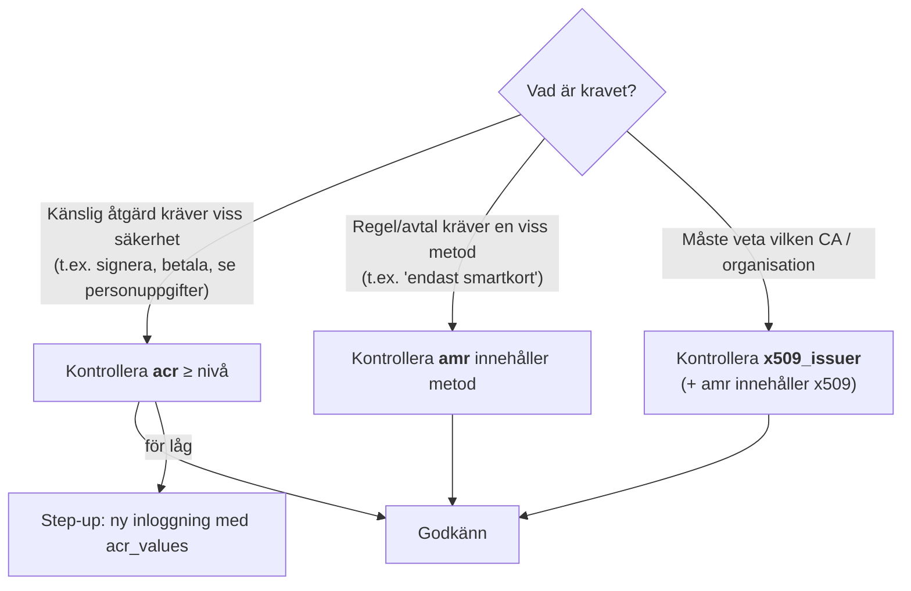
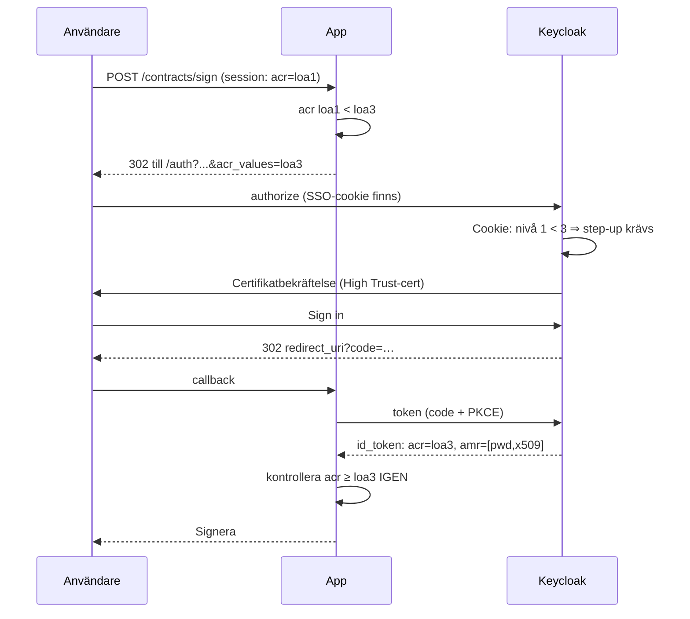

# Guide för applikationsägare och utvecklare – `acr` och `amr`

Den här guiden beskriver hur din applikation läser och kontrollerar **tillitsnivå** (`acr`) och
**inloggningsmetod** (`amr`) i token från Keycloak, och hur du begär en högre nivå (step-up).

## Innehåll

1. [Vad är `acr` och `amr`?](#1-vad-är-acr-och-amr)
2. [Referenstabell](#2-referenstabell)
3. [När ska du kontrollera vad?](#3-när-ska-du-kontrollera-vad)
4. [Kodexempel](#4-kodexempel)
5. [Step-up Authentication med `acr_values`](#5-step-up-authentication-med-acr_values)
6. [Säkerhetsrekommendationer](#6-säkerhetsrekommendationer)
7. [Testa med Bruno](#7-testa-med-bruno)

---

## 1. Vad är `acr` och `amr`?

| Claim | Namn | Typ | Svarar på frågan | Exempel |
|-------|------|-----|------------------|---------|
| `acr` | Authentication Context Class Reference | sträng | *Hur säker är inloggningen?* (Level of Assurance, LoA) | `"loa2"` |
| `amr` | Authentication Methods References ([RFC 8176](https://www.rfc-editor.org/rfc/rfc8176)) | lista av strängar | *Exakt vilka metoder användes?* | `["x509"]` |
| `x509_issuer` | (eget claim) | sträng | *Vilken CA utfärdade certifikatet?* (endast vid X.509) | `"CN=Test CA High Trust,O=Example Org,C=SE"` |

Tumregel: **`acr` är ett policybeslut** som identitetsleverantören tar åt dig ("den här inloggningen håller
nivå 3"). **`amr` är ett faktum** om vad som hände. Bygg dina regler på `acr`; använd `amr` bara när du har ett
konkret krav på en viss metod.

Nivåerna är ordnade: `loa1 < loa2 < loa3`. En regel "kräver loa2" ska därför acceptera både `loa2` och `loa3`.

## 2. Referenstabell

| Inloggningsmetod | `acr` | `amr` | `x509_issuer` |
|------------------|-------|-------|---------------|
| Användarnamn och lösenord | `loa1` | `["pwd"]` | – |
| Passkey (WebAuthn) | `loa2` | `["hwk"]` | – |
| Klientcertifikat utfärdat av **Test CA Standard** | `loa2` | `["x509"]` | `CN=Test CA Standard,O=Example Org,C=SE` |
| Klientcertifikat utfärdat av **Test CA High Trust** | `loa3` | `["x509"]` | `CN=Test CA High Trust,O=Example Org,C=SE` |
| Lösenord + step-up med Passkey | `loa2` | `["pwd","hwk"]` | – |
| Lösenord + step-up med High Trust-certifikat | `loa3` | `["pwd","x509"]` | `CN=Test CA High Trust,…` |
| Certifikat från en CA som inte är godkänd | *ingen token* – inloggningen nekas | | |

Var claims finns:

| | ID token | Access token | Introspection | UserInfo |
|--|:--:|:--:|:--:|:--:|
| `acr` | ✅ | ✅ | ✅ | – |
| `amr` | ✅ | ✅ | – ¹ | – |
| `x509_issuer` | ✅ | ✅ | ✅ | – |

¹ Keycloak 26.6:s `amr`-mapper stöder inte introspection. Läs `amr` ur den validerade JWT:n.

> **Observera:** `acr` och `amr` beskriver **sessionen**. Vid SSO (användaren är redan inloggad) får du
> sessionens högsta fortfarande giltiga nivå och de metoder som använts i sessionen – inte bara det som hände
> i just din inloggning.

## 3. När ska du kontrollera vad?



- **Kontrollera `acr`** i normalfallet. Då kan IdP:n byta eller lägga till metoder (t.ex. en ny CA på nivå 3)
  utan att din kod ändras.
- **Kontrollera `amr`** bara när kravet faktiskt gäller metoden, t.ex. revision ("loggade in med certifikat")
  eller ett regelverk som kräver phishing-resistent metod (`hwk` eller `x509`).
- **Kontrollera `x509_issuer`** endast om du måste skilja på utfärdare. Kontrollera alltid även att `amr`
  innehåller `x509`.

## 4. Kodexempel

Alla exempel validerar **signatur, `iss`, `aud` och `exp`** innan något claim används. Värden för POC:n:

| | Värde |
|--|-------|
| Issuer | `https://localhost:8443/realms/acr-poc` |
| JWKS | `https://localhost:8443/realms/acr-poc/protocol/openid-connect/certs` |
| ID token `aud` | `bruno` (klientens `client_id`) |
| Access token `aud` | `poc-api` (backend-API:t) |

> POC:ns servercertifikat är utfärdat av en test-CA. Låt din runtime lita på `certs/ca-standard.crt`
> (t.ex. `NODE_EXTRA_CA_CERTS=certs/ca-standard.crt`, `REQUESTS_CA_BUNDLE=…`, eller en Java truststore).

### 4.1 Gemensam nivålogik

Samma regel på alla ställen: översätt `acr` till en siffra och jämför. Okänt eller saknat värde = nivå 0.

```js
// acr.js
export const LOA = Object.freeze({ loa1: 1, loa2: 2, loa3: 3 });
export const loaOf = (acr) => LOA[acr] ?? 0;           // okänt/saknat ⇒ 0 (fail closed)
export const meetsAcr = (claims, required) => loaOf(claims.acr) >= LOA[required];
```

### 4.2 Webbapp – validera ID token (Node.js, [`jose`](https://github.com/panva/jose))

```js
import { createRemoteJWKSet, jwtVerify } from "jose";
import { meetsAcr } from "./acr.js";

const ISSUER = "https://localhost:8443/realms/acr-poc";
const JWKS = createRemoteJWKSet(new URL(`${ISSUER}/protocol/openid-connect/certs`));

/**
 * Validerar ID token efter callback. nonce = värdet du sparade i sessionen innan redirect.
 */
export async function verifyIdToken(idToken, expectedNonce) {
  const { payload } = await jwtVerify(idToken, JWKS, {
    issuer: ISSUER,
    audience: "bruno",                 // din client_id
    algorithms: ["RS256"],
    clockTolerance: 30,
  });
  if (payload.nonce !== expectedNonce) throw new Error("nonce mismatch");
  return payload;
}

// Användning i callback-hanteraren:
const claims = await verifyIdToken(tokens.id_token, req.session.nonce);
req.session.user = { sub: claims.sub, acr: claims.acr, amr: claims.amr ?? [] };

// Skydda en känslig sida:
app.get("/sign", (req, res) => {
  if (!meetsAcr(req.session.user, "loa3")) {
    return res.redirect("/login?acr=loa3");   // step-up, se avsnitt 5
  }
  res.render("sign");
});
```

### 4.3 Backend-API – validera Access token (Node.js/Express)

API:t svarar med `401` och `WWW-Authenticate: … error="insufficient_user_authentication"` enligt
[RFC 9470](https://www.rfc-editor.org/rfc/rfc9470) när nivån är för låg, så att klienten vet att den ska göra step-up.

```js
import { createRemoteJWKSet, jwtVerify } from "jose";
import { meetsAcr } from "./acr.js";

const ISSUER = "https://localhost:8443/realms/acr-poc";
const JWKS = createRemoteJWKSet(new URL(`${ISSUER}/protocol/openid-connect/certs`));

/** Express-middleware: kräver giltig access token med minst `requiredAcr`. */
export const requireAcr = (requiredAcr) => async (req, res, next) => {
  const token = (req.headers.authorization ?? "").replace(/^Bearer /, "");
  let claims;
  try {
    ({ payload: claims } = await jwtVerify(token, JWKS, {
      issuer: ISSUER,
      audience: "poc-api",            // API:ts egen identitet, inte klientens
      algorithms: ["RS256"],
    }));
  } catch {
    return res.status(401).set("WWW-Authenticate", 'Bearer error="invalid_token"')
      .json({ error: { code: "INVALID_TOKEN", message: "The access token is invalid." } });
  }
  if (!meetsAcr(claims, requiredAcr)) {
    return res.status(401)
      .set("WWW-Authenticate", `Bearer error="insufficient_user_authentication", acr_values="${requiredAcr}"`)
      .json({ error: { code: "INSUFFICIENT_AUTHENTICATION", message: `Requires ${requiredAcr}.` } });
  }
  req.auth = claims;
  next();
};

app.get("/api/profile", requireAcr("loa1"), handler);
app.post("/api/payments", requireAcr("loa2"), handler);
app.post("/api/contracts/sign", requireAcr("loa3"), handler);

// Exakt metod (endast när regelverket kräver det): phishing-resistent inloggning
const PHISHING_RESISTANT = ["hwk", "x509"];
const requirePhishingResistant = (req, res, next) =>
  (req.auth.amr ?? []).some((m) => PHISHING_RESISTANT.includes(m))
    ? next()
    : res.status(403).json({ error: { code: "METHOD_NOT_ALLOWED", message: "Phishing-resistant login required." } });
```

### 4.4 Backend-API – Spring Boot Resource Server (Java)

```java
@Configuration
@EnableMethodSecurity
class SecurityConfig {

    static final String ISSUER = "https://localhost:8443/realms/acr-poc";

    @Bean
    JwtDecoder jwtDecoder() {
        NimbusJwtDecoder decoder = JwtDecoders.fromIssuerLocation(ISSUER);
        OAuth2TokenValidator<Jwt> audience = new JwtClaimValidator<List<String>>(
                JwtClaimNames.AUD, aud -> aud != null && aud.contains("poc-api"));
        decoder.setJwtValidator(new DelegatingOAuth2TokenValidator<>(
                JwtValidators.createDefaultWithIssuer(ISSUER), audience));
        return decoder;
    }

    @Bean
    SecurityFilterChain api(HttpSecurity http) throws Exception {
        return http
                .authorizeHttpRequests(a -> a.anyRequest().authenticated())
                .oauth2ResourceServer(o -> o.jwt(Customizer.withDefaults()))
                .build();
    }
}

/** Nivålogik på ett ställe. Används från @PreAuthorize: @acr.atLeast(authentication, 'loa3') */
@Component("acr")
class AcrPolicy {
    private static final Map<String, Integer> LOA = Map.of("loa1", 1, "loa2", 2, "loa3", 3);

    public boolean atLeast(Authentication auth, String required) {
        if (!(auth instanceof JwtAuthenticationToken jwt)) return false;
        int actual = LOA.getOrDefault(jwt.getToken().getClaimAsString("acr"), 0);
        return actual >= LOA.get(required);
    }

    public boolean usedMethod(Authentication auth, String method) {
        if (!(auth instanceof JwtAuthenticationToken jwt)) return false;
        List<String> amr = jwt.getToken().getClaimAsStringList("amr");
        return amr != null && amr.contains(method);
    }
}

@RestController
class ContractController {
    @PostMapping("/api/contracts/sign")
    @PreAuthorize("@acr.atLeast(authentication, 'loa3')")
    ResponseEntity<Void> sign() { return ResponseEntity.noContent().build(); }
}
```

### 4.5 Backend-API – Python ([PyJWT](https://pyjwt.readthedocs.io/))

```python
import jwt  # pip install "pyjwt[crypto]"

ISSUER = "https://localhost:8443/realms/acr-poc"
JWKS = jwt.PyJWKClient(f"{ISSUER}/protocol/openid-connect/certs")
LOA = {"loa1": 1, "loa2": 2, "loa3": 3}

def verify_access_token(token: str) -> dict:
    key = JWKS.get_signing_key_from_jwt(token)
    return jwt.decode(token, key.key, algorithms=["RS256"], audience="poc-api", issuer=ISSUER,
                      options={"require": ["exp", "iat", "iss", "aud", "sub"]})

def meets_acr(claims: dict, required: str) -> bool:
    return LOA.get(claims.get("acr"), 0) >= LOA[required]

claims = verify_access_token(bearer_token)
if not meets_acr(claims, "loa2"):
    raise InsufficientAuthentication(required="loa2")   # -> 401 + WWW-Authenticate (RFC 9470)
```

## 5. Step-up Authentication med `acr_values`

När en användare med för låg nivå försöker göra något känsligt skickar du hen till Keycloak igen med önskad nivå.
Användaren behåller sin session (SSO) och behöver bara genomföra det som saknas.



### Begära nivå

```text
GET https://localhost:8443/realms/acr-poc/protocol/openid-connect/auth
    ?client_id=bruno
    &response_type=code
    &scope=openid
    &redirect_uri=http://localhost:8081/callback
    &state=<slump>&nonce=<slump>
    &code_challenge=<S256(verifier)>&code_challenge_method=S256
    &acr_values=loa3
```

| Parameter | Beteende |
|-----------|----------|
| `acr_values=loa3` | **Frivillig** begäran. Keycloak försöker nå nivån, men om användaren väljer en svagare metod utfärdas ändå token med lägre `acr` (verifierat: lösenord ⇒ `acr=loa1`). **Din app måste kontrollera `acr`.** |
| `claims={"id_token":{"acr":{"essential":true,"values":["loa3"]}}}` | **Obligatorisk** begäran. Keycloak utfärdar ingen token om nivån inte uppnås (användaren får en felsida). Använd när du hellre vill ha ett hårt stopp än en kontroll i appen. Kontrollera ändå `acr`. |
| `prompt=login` / `max_age=<s>` | Tvingar omautentisering, även om sessionen redan har nivån. Använd för "bekräfta med certifikat nu" vid t.ex. signering. Kontrollera `auth_time`. |

Vilka nivåer som kan nås med vad:

| Begärd nivå | Användaren kan använda |
|-------------|------------------------|
| `loa1` | Lösenord, Passkey, certifikat (båda CA:er) |
| `loa2` | Passkey, certifikat från Test CA Standard eller High Trust |
| `loa3` | Endast certifikat från Test CA High Trust |

> Om en användare utan passkey och utan certifikat begär `loa2` visar Keycloak en felsida. Hantera
> felsvaret (`error` i callback) och visa en begriplig instruktion ("registrera en passkey i kontot").

## 6. Säkerhetsrekommendationer

1. **Lita bara på signerade, validerade token.** Validera signatur (mot JWKS), `iss`, `aud`, `exp` (och `nonce`
   för ID token) innan du läser `acr`/`amr`. Avkoda aldrig bara base64 i produktion (Bruno-skripten gör det
   endast för inspektion).
2. **Lita inte på klientparametrar.** Att din frontend skickade `acr_values=loa3` betyder ingenting – kontrollera
   `acr` i den token du fick tillbaka. Ta aldrig emot `acr`/`amr` från query-parametrar, headers eller formulär.
3. **Styr affärsregler på `acr`, inte på hårdkodade metoder.** `acr ≥ loa2` fortsätter fungera när IdP:n lägger
   till en ny metod eller CA. Kontrollera `amr` endast när ett krav uttryckligen gäller metoden.
4. **Fail closed.** Saknat eller okänt `acr` = lägsta nivå (0). Okänt `amr`-värde ger ingen extra behörighet.
5. **Rätt token till rätt mottagare.** Webbappen läser ID token (`aud` = din `client_id`); API:t läser
   access token (`aud` = API:ts identitet). Skicka aldrig ID token till ett API.
6. **Kontrollera nivån vid varje känslig åtgärd**, inte bara vid inloggning – sessionen kan vara gammal.
   Kombinera med `auth_time`/`max_age` om åtgärden kräver färsk inloggning.
7. **Signalera step-up korrekt från API:er** med `401` + `WWW-Authenticate: Bearer error="insufficient_user_authentication", acr_values="loa3"` (RFC 9470), så att klienten kan starta om inloggningen.
8. **Använd alltid PKCE (S256), `state` och `nonce`.** Test-klienten `bruno` kräver PKCE.
9. **Logga beslut, inte token.** Logga `sub`, `acr`, `amr` och beslut – aldrig hela token.
10. **`x509_issuer` är information, inte en nyckel.** Använd det för revision eller specifika krav; nivåbeslutet
    har redan fattats av IdP:n i `acr`.

## 7. Testa med Bruno

Collectionen i [`bruno/`](../bruno) innehåller färdiga requests:

| Request | Syfte |
|---------|-------|
| `01 Discovery` | Läser `.well-known/openid-configuration`, kontrollerar att `loa1–loa3` och PKCE S256 annonseras |
| `02 Login - Standard` | Bygger authorize-URL med PKCE, utan `acr_values` |
| `03 Login - Step-up LoA 2` | Samma med `acr_values=loa2` |
| `04 Login - Step-up LoA 3` | Samma med `acr_values=loa3` |
| `05 Token Exchange` | Växlar `authCode`, dekodar ID/Access token, loggar `acr`/`amr`/`x509_issuer` och testar att begärd nivå uppnåddes |
| `06 UserInfo` | Kontrollerar att sessionen är aktiv |
| `07 Token Introspection` | Visar hur ett API (`poc-api`) ser tokenet |

### Arbetsgång

1. Öppna mappen `bruno/` i Bruno (*Open Collection*) och välj miljön **local**.
2. Sätt `apiClientSecret` = `poc-api-secret-change-me` i miljön (det är en *secret*-variabel och lagras inte i filen).
3. Låt Bruno lita på test-CA:n: *Preferences → General → Custom CA Certificate* → `certs/ca-standard.crt`
   (eller stäng av *SSL/TLS Certificate Verification* lokalt).
4. Kör `01 Discovery`.
5. Kör t.ex. `04 Login - Step-up LoA 3`. Öppna URL:en från **Timeline/Console** i en webbläsare.
6. Logga in. Callback-sidan `http://localhost:8081/callback` visar koden – kopiera den (eller hela URL:en)
   till miljövariabeln `authCode`.
7. Kör `05 Token Exchange` inom ~60 sekunder. Resultatet visas i konsolen och under *Tests*.

### Klientcertifikat (mTLS)

Inloggningen görs i **webbläsaren**, så det är där certifikatet ska finnas:

| Webbläsare | Import |
|------------|--------|
| Firefox | *Inställningar → Sekretess och säkerhet → Certifikat → Visa certifikat → Dina certifikat → Importera* → `certs/testuser-high.p12` (lösenord `changeit`) |
| Chrome/Edge (Linux) | `chrome://certificate-manager` → *Dina certifikat → Importera*, eller `pk12util -d sql:$HOME/.pki/nssdb -i certs/testuser-high.p12` |
| Chrome/Edge (Windows) | Dubbelklicka på `.p12` → importera till *Personligt* |
| macOS | Dubbelklicka på `.p12` → Nyckelhanteraren (*login*) |

Importera även `certs/ca-standard.crt` som betrodd CA för webbplatser (servercertifikatet för `localhost`).
Webbläsaren frågar vilket certifikat som ska användas; välj Standard eller High Trust beroende på test.
Starta om webbläsaren eller öppna ett privat fönster för att byta certifikat (TLS-sessionen cachar valet).

Bruno själv behöver inget klientcertifikat (token-, userinfo- och introspection-anropen kräver inte mTLS).
Vill du ändå skicka ett, aktivera `clientCertificates` i `bruno/bruno.json` (förifylld med High Trust-certet)
eller under *Collection Settings → Client Certificates*.

### Utan webbläsare

`scripts/e2e_test.py --issue-code testuser-high --acr-values loa3` loggar in med certifikatet från kommandoraden
och skriver ut `code` och `verifier`, som kan användas som `authCode`/`codeVerifier`
(se `scripts/validate-bruno.sh`).
